<div align="center">


# Ruodao Guard · Desktop

**A local-first security & speed toolkit for Windows**

Health Check · Malware Scan · Junk Cleanup · Software Manager · Driver Manager · Speed Center · System Repair · AI Security Assistant

[](#requirements)
[](#tech-stack)
[](#tech-stack)
[](#tech-stack)
[](LICENSE)
[](#contributing)

**[简体中文](README.md) · [English](README.en.md)**

</div>

---

## 📖 Overview

A computer that has been in use for a while accumulates problems all at once: the C: drive is nearly full, a pile of programs auto-start at boot, uninstalled software leaves debris behind, drivers are years out of date, system services have been silently disabled, the browser homepage got hijacked, and you are never quite sure whether that file you downloaded was safe. All of this should be handled in one place — but in reality it is scattered across Settings, Control Panel, Task Manager, Device Manager and Windows Security, plus a handful of third-party utilities. **Figuring out "what state is this machine actually in" means clicking through seven or eight panels, none of which are readable.**

Ruodao Guard pulls it all into one desktop app:

- **A single 0–100 health score** with an itemized breakdown underneath, so you can see exactly what is dragging it down — and jump straight to the fix with one click;
- **Eight capability areas** covering health checks, malware scanning, cleanup, uninstalling, drivers, performance, repairs and AI Q&A — all executed **locally**;
- **Every system-modifying action is traceable**: configuration is backed up before repair, disabled startup entries go to a backup store, quarantined files are moved rather than deleted, and risky operations are logged separately;
- **An AI security assistant** that can read your local health report and answer "why is my PC slow" — but it **only advises, it never deletes files for you**.

> **Relationship to the [Ruodao Guard plugin](https://github.com/ruodaoai/ruodao-guard)**
> That repository is a lightweight plugin that runs inside the Ruodao desktop client (pure Node.js, no drivers, no background process). **This repository is the full standalone desktop application**: it ships its own Electron runtime, native window and installer, with the UI and features reimplemented for desktop. It does not require the Ruodao client.

> **⚠️ Let's be upfront**
> This is a **local system maintenance and security-education** project, **not a replacement for a commercial antivirus engine**. The built-in signature database currently contains only the EICAR standard test sample plus filename heuristics, and **cannot replace Windows Defender or any real antivirus product**. Its real value is this: it turns system state, reversible system operations and the scanning pipeline into an implementation that is **fully open, auditable and learnable**. Please read [Scope & Disclaimer](#disclaimer) before use.

---

## 🖼️ Screenshots

| Health check (idle) | Health check (score & findings) |
| --- | --- |
| 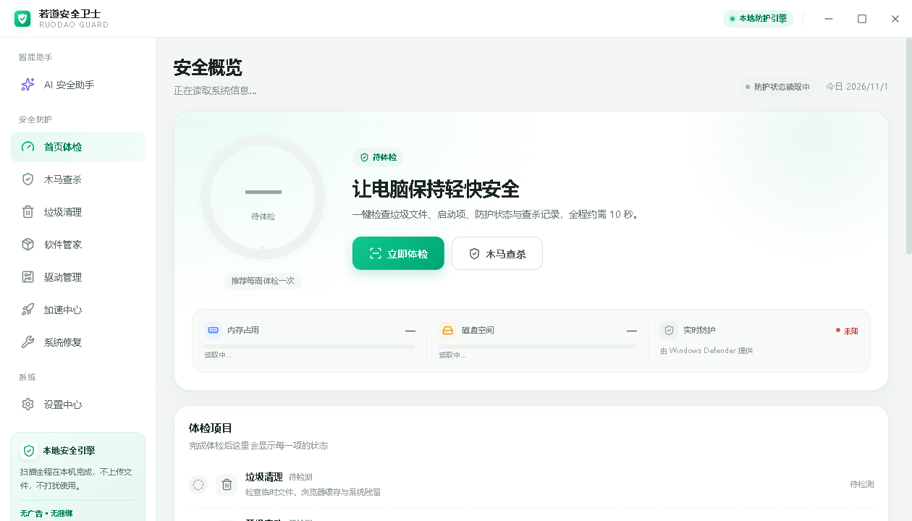 | 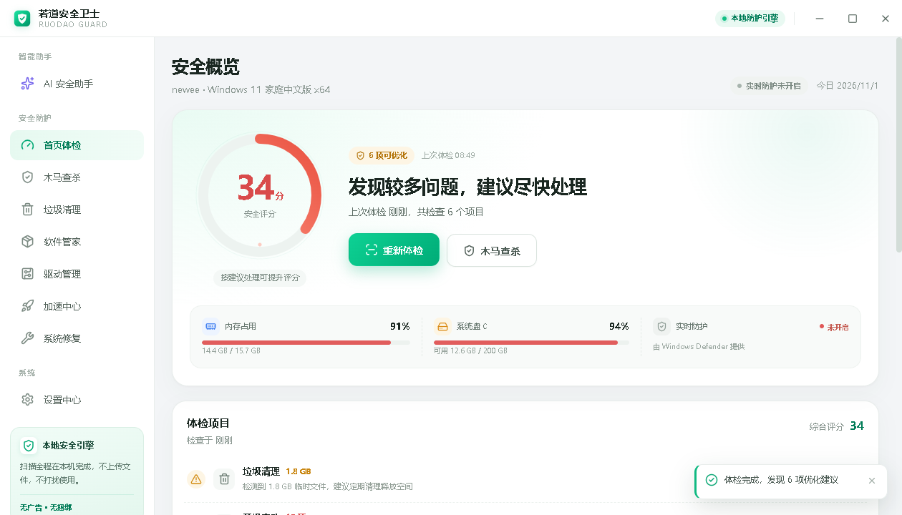 |

| Malware scan (engine ready) | Scan results |
| --- | --- |
| 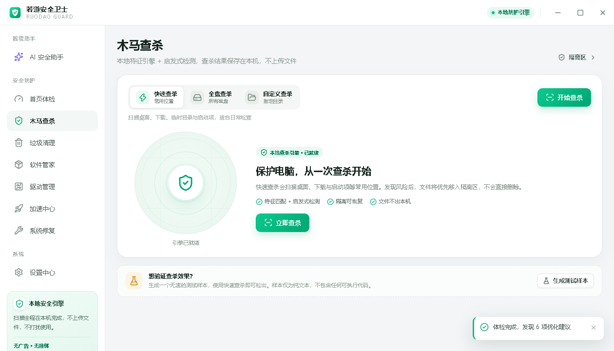 | 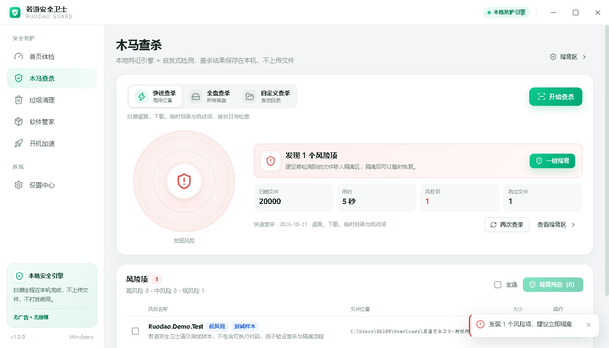 |

| Quarantine & privacy notes | Junk cleanup |
| --- | --- |
| 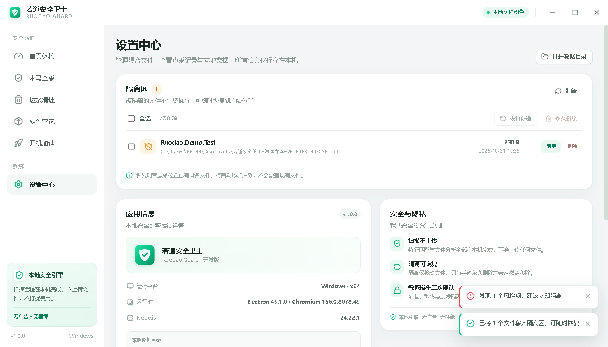 | 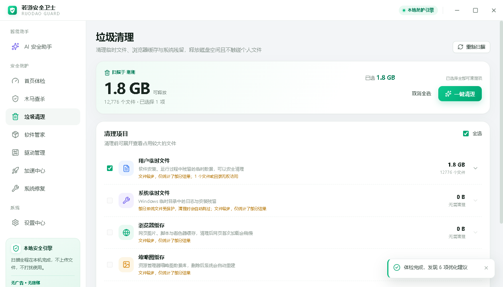 |

| Software manager | Driver manager |
| --- | --- |
| 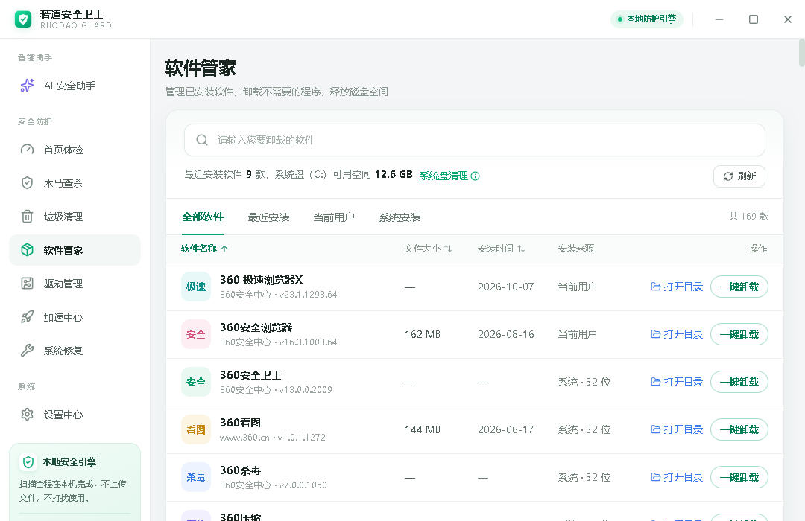 | 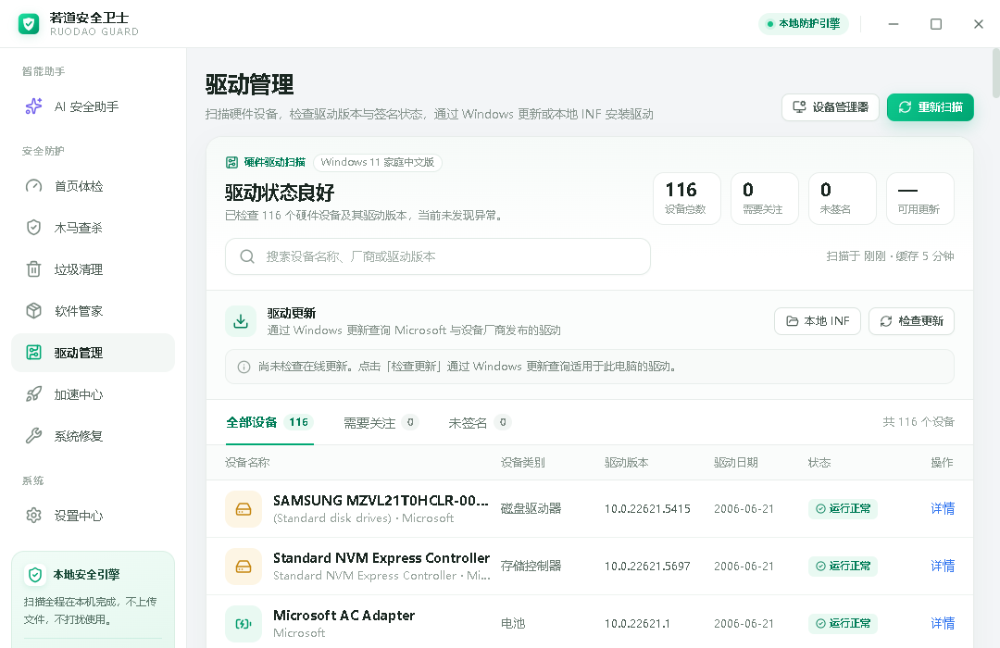 |

| Speed center | Startup management |
| --- | --- |
| 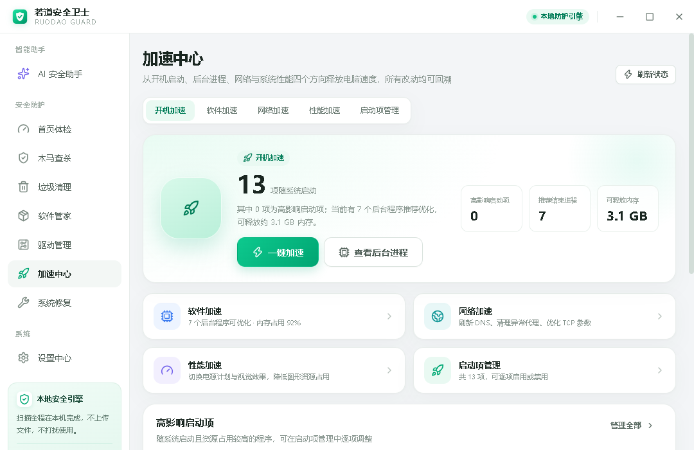 | 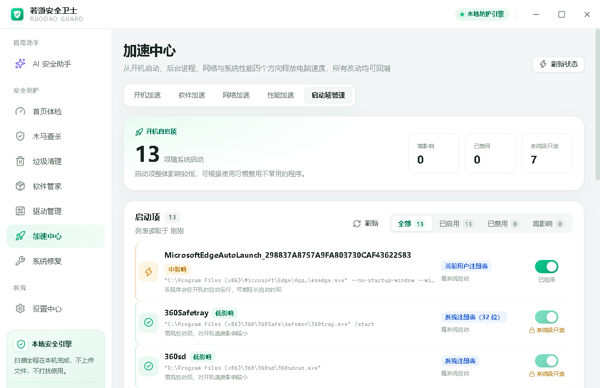 |

| System repair | Repair confirmation (with backup & logging notice) |
| --- | --- |
| 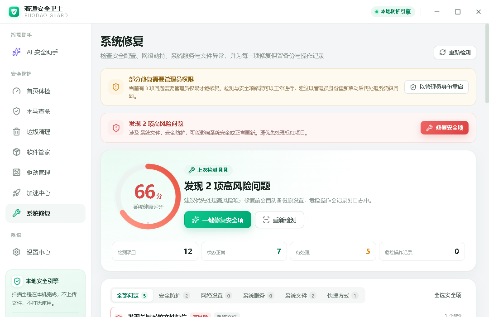 | 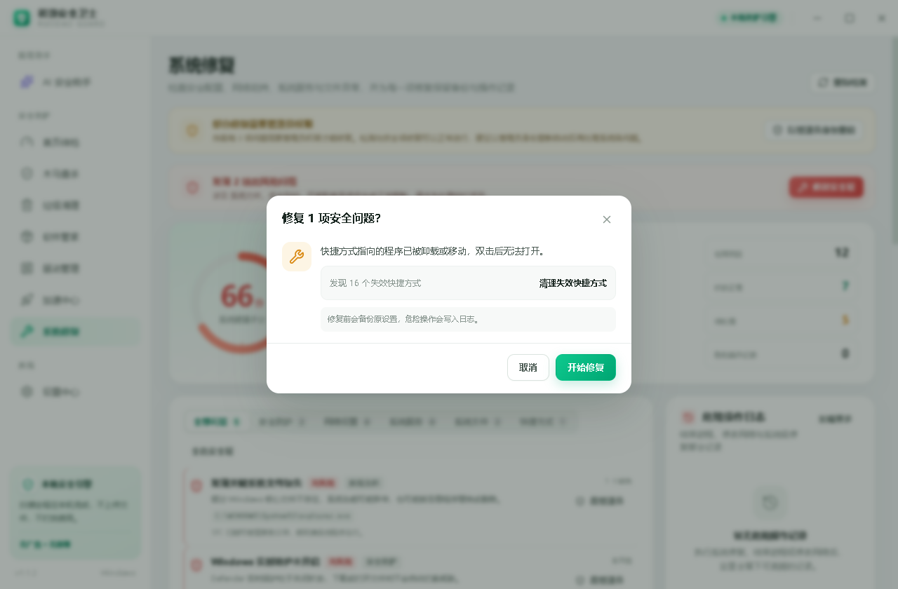 |

| AI assistant (welcome) | AI assistant (answering from local health data) |
| --- | --- |
| 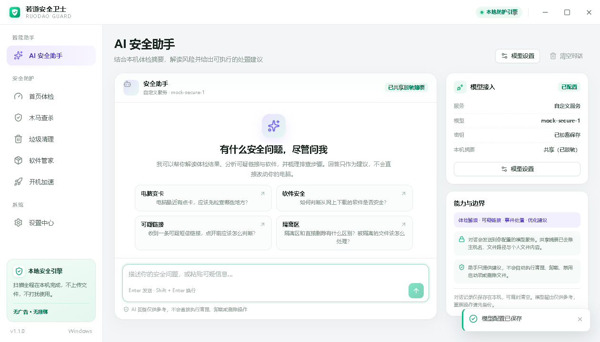 | 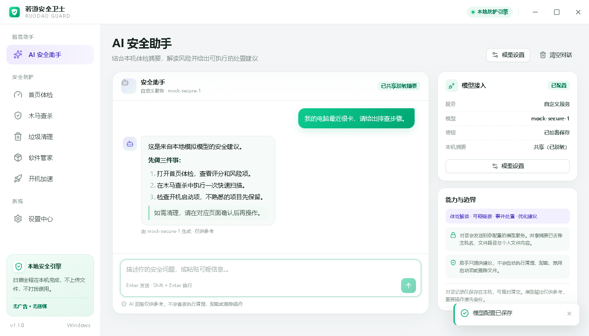 |

| Settings (model config / quarantine / app info) | |
| --- | --- |
| 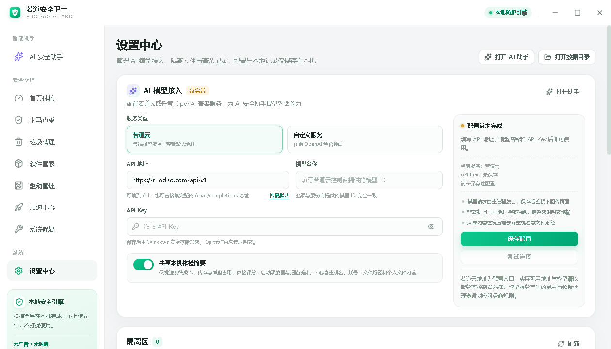 | |

---

## ✨ Features

| Module | What it does | Notable implementation |
| --- | --- | --- |
| 🩺 **Health check** | Runs system, junk, startup and protection checks in one pass; produces a 0–100 score plus a findings list, each linking to its fix | Staged progress events so long checks feel responsive |
| 🛡️ **Malware scan** | Quick / full / custom modes; SHA-256 signature matching + double-extension heuristics; hits go to quarantine first | Scanning is fully local — no files or hashes leave the machine |
| 🗄️ **Quarantine** | List / restore / delete permanently; on restore, an existing file at the original path never gets overwritten | Atomic JSON index, move-not-delete semantics |
| 🧹 **Junk cleanup** | User temp, system temp, browser cache, thumbnails, crash dumps; per-category size before cleaning | Directory allowlist, per-run caps, timeout guards |
| 📦 **Software manager** | Reads three uninstall registry hives (64-bit / 32-bit / current user); search, sort, open install folder, one-click uninstall | Prefers the app's silent uninstall arguments |
| 🔌 **Driver manager** | Enumerates hardware and driver versions, flags unsigned / attention-needed devices, queries driver updates via Windows Update, installs updates or a local INF | Elevated helper process + `pnputil` |
| 🚀 **Speed center** | Boot speed, process termination, network tuning (DNS / TCP / Winsock / proxy), performance (power plan / visual effects), startup management | Every change is recorded and reversible |
| 🔧 **System repair** | Detects broken services, security policies, real-time protection, firewall, UAC, pending reboots, hosts, proxy, broken shortcuts, missing system files, suspicious startup entries | Backs up original config first; writes a risk-operation log |
| 🤖 **AI security assistant** | Security Q&A grounded in your local health summary; streaming output, cancellable; works with Ruodao Cloud or any OpenAI-compatible endpoint | API keys encrypted at rest with Windows DPAPI |
| ⚙️ **Settings** | Model configuration, quarantine, scan history, app info & data directory | All data stored locally only |

---

## 📥 Installation

### Option 1: Installer (recommended for end users)

1. Open the [Releases](../../releases) page;
2. Download the latest `RuodaoGuard-Setup-x.y.z.exe`;
3. Run it. The installer lets you **choose the install directory** and creates desktop and Start Menu shortcuts. It installs **per-user and does not require administrator rights**.

> The installer is not code-signed, so Windows SmartScreen may warn about an "unknown publisher". If that bothers you, build it yourself from source — that is the whole point of open source.

### Option 2: Run from source

```bash
git clone https://github.com/ruodaoai/ruodao-guard-desktop.git
cd ruodao-guard-desktop
npm install
npm run dev
```

Build an installer:

```bash
npm run dist:win      # output goes to release/
```

> The repo includes an `.npmrc` pointing at the npmmirror registry to speed up Electron downloads in mainland China. Outside that network, delete `.npmrc` or switch it back to the official registry.

### Requirements

| Item | Requirement |
| --- | --- |
| OS | Windows 10 / 11, x64 |
| RAM | 4 GB or more recommended |
| Privileges | **No administrator needed for daily use**; system repair, driver installation and some startup operations require elevation — the app offers "Relaunch as administrator" |
| Dev environment | Node.js 22+, npm 10+ |

---

## 🚀 Usage guide

### 1. Health check

The app opens on this page.

1. Click **"Check now"**. The UI walks through *reading system state → scanning junk → checking startup items → checking protection → computing score*, roughly 10 seconds;
2. A ring gauge appears on the left: **90+ excellent, 70+ good, below 70 needs attention**;
3. The findings list on the right is sorted by severity (high → medium → low). Each entry states **why points were deducted** and **what to do**;
4. Click "Clean up / Optimize / Scan" on any row to jump directly to the relevant page.

> The score is driven by real metrics only — no fear-mongering. Junk size, startup count, memory usage, free disk space, real-time protection state, and the result/age of the last scan each have explicit thresholds (see [Scoring rules](#scoring-rules)).

### 2. Malware scan

1. Choose a scan mode:
   - **Quick** — desktop, downloads, temp directories and startup folders; good for routine checks;
   - **Full** — all local disks;
   - **Custom** — pick any folder with "Choose folder";
2. Click **"Start scan"**. The right panel shows live file counts and the current path; you can stop at any time;
3. If anything is found, the threat count appears at the top. Click **"Quarantine all"** to move the files into quarantine — **nothing is deleted outright**;
4. Results and statistics are written to local scan history, viewable under Settings → Scan history.

**Want to verify the detection pipeline actually works?** The scan page has a "Want to verify detection?" card. Click **"Generate test sample"** and a plain-text demo sample (containing no executable code) is created in your Downloads folder. Run a quick scan and you will see it detected, quarantined and restorable — the full loop, end to end. The standard EICAR test string is detected as well.

> Performance note: a first full scan walks a lot of directories. The scanner skips high-risk system areas such as `WinSxS`, `DriverStore`, `Windows.old` and the Recycle Bin, and caps file counts per run so the machine stays responsive.

### 3. Quarantine

Location: **Settings → Quarantine**.

| Action | Behavior |
| --- | --- |
| Restore | Moves the file back to its original path; if a file already exists there, a `.restored` suffix is appended — **never overwrites** |
| Delete permanently | Really removes it from disk, requires a second confirmation, **irreversible** |
| Refresh | Re-reads the quarantine index |

Quarantined files sit inertly in the app data directory. They are never executed and never uploaded.

### 4. Junk cleanup

1. Open "Junk cleanup" and wait for the scan; total reclaimable size is shown at the top;
2. Expand each category to see **actual usage**: user temp, system temp, browser cache, thumbnail cache, crash dumps;
3. Tick the categories to clean (all selected by default) and click **"Clean now"**;
4. A summary reports space freed plus deleted/skipped file counts.

> Cleaning is restricted to an **explicit allowlist of cache and temp directories** — your documents, photos and downloads are untouched. After clearing browser cache, the first page load will be slightly slower; that is expected. If a category reports "file count high, showing partial results", it exceeded the per-run cap and will be processed in batches.

### 5. Software manager

1. The list shows all installed software. Filter by **recently installed / current user / system-wide**, or click column headers to sort by name, size or install date;
2. The search box filters by name as you type;
3. Two actions per row:
   - **Open folder** — jump to the install location;
   - **Uninstall** — after confirmation, invokes the program's own uninstaller (silent arguments preferred).

> The app only reads registered uninstall entries — it does **not** scan the filesystem or compute "leftover junk". Portable/green software therefore will not appear here.

### 6. Driver manager

1. The page scans automatically; four headline numbers show device count, devices needing attention, unsigned drivers and available updates;
2. Filter by **All devices / Needs attention / Unsigned**, or search by device name or vendor;
3. **"Check for updates"** queries Windows Update online for drivers applicable to this machine (the Windows Update service must be running);
4. Select available updates and install; alternatively click **"Local INF"** to install from a specific `.inf` file;
5. For misbehaving devices, **"Device Manager"** opens the native Windows tool.

> **Risk notice**: driver updates touch the lowest layers of the system. **Update only the devices flagged as abnormal**, and create a restore point first. Installation requires administrator rights; the app will request elevation.

### 7. Speed center

Five tabs covering the four usual causes of "my PC is slow":

**① Boot speed** — shows auto-start entry count, high-impact entries and reclaimable memory. **"Boost now"** disables entries that clearly slow boot; **"View background processes"** jumps to the process list.

**② Software speed** — lists processes with high CPU / memory usage (PID, CPU%, memory). Tick and **"End process"**. Dangerous processes are blocked, and terminations are written to the risk-operation log.

**③ Network speed** — four independent switches:

| Item | Command actually run |
| --- | --- |
| Flush DNS cache | `ipconfig /flushdns` |
| Clear abnormal proxy | Disables the system proxy setting |
| Optimize TCP parameters | `netsh int tcp set global autotuninglevel=normal` |
| Reset Winsock | `netsh winsock reset` (requires reboot) |

**④ Performance** — switch power plan (high performance / balanced / power saver) and visual effects (best performance / balanced / best appearance), saving the previous settings first.

**⑤ Startup management** — lists registry Run entries and startup-folder entries with source and vendor, each individually enable-able/disable-able.

> **Disabling startup entries is reversible.** Registry values are moved into a backup key rather than deleted, and startup-folder items are moved into the app data directory with a manifest. Click "Enable" any time to restore them exactly — this is the "every change is traceable" principle in practice.

### 8. System repair

Checks (a dozen-plus items, grouped):

| Category | What is checked |
| --- | --- |
| System services | 11 critical services (crypto, DNS, event log, WMI, task scheduler, printing, …) stopped or with a wrong start type |
| Security policy | Task Manager / Registry Editor / Windows Update disabled by policy |
| Protection | Windows real-time protection and firewall enabled |
| Account security | User Account Control (UAC) turned off |
| Network hijacking | Suspicious hosts entries, maliciously configured system proxy |
| System files | Missing critical system files (runs an SFC scan) |
| Pending reboot | Updates waiting for a restart to complete |
| Shortcuts | Broken desktop and Start Menu shortcuts |
| Startup | Suspicious persistence entries |

Workflow:

1. The page checks automatically and shows a **system health score** plus counts (healthy / pending);
2. Tick items to fix, or click **"Fix security items"** (security-only, lowest risk);
3. A confirmation dialog **states exactly what will be changed and what will be backed up**;
4. Repair runs (some items need administrator — the page says so up front);
5. The **risk-operation log** on the right keeps an auditable record.

> **Original configuration is backed up before repair.** Changing system settings is high risk: confirm item by item, change one or two things at a time, and observe the result. The log lives at `risk-events.json` in the data directory.

### 9. AI security assistant

Because it can read your local health report, it can answer concrete questions like "my PC has been slow lately, give me a troubleshooting plan".

1. Configure a model first: **"Model settings"** in the top-right, or Settings → AI model access:
   - **Ruodao Cloud** — enter an API key from your Ruodao console; optionally sign in to load the model list automatically;
   - **Custom service** — any OpenAI-compatible endpoint: base URL, model ID, API key;
2. Click **"Test connection"** to verify;
3. Return to the assistant and type a question, or start from a suggested prompt;
4. Answers stream in and can be stopped at any moment;
5. **"Clear chat"** removes local conversation history.

**It will not act on your behalf.** The assistant only produces recommendations and paths through the UI. Cleaning, scanning, uninstalling and changing system settings must all be confirmed by you on the corresponding page — that boundary is deliberate.

**Context sharing** can be disabled in settings. When enabled, the payload is a **health summary**: app version, memory/disk usage, health score, startup entry count, scan statistics. It **excludes** hostname, username, file paths and any file content. API keys are encrypted with Windows DPAPI (Electron `safeStorage`) and stored locally; the plaintext cannot be read back from the UI.

### 10. Settings

- **AI model access** — provider, API base URL, model ID, API key, test connection, share-health-summary toggle;
- **Quarantine** — see above;
- **Scan history** — time, mode, file count and threat count of every scan;
- **App info** — version, Electron / Chromium / Node versions, data directory location;
- **Open data directory** — jump to the local data folder for auditing or backup.

---

## 🔐 Security model & privacy

An app that reads system state and changes system settings deserves its own security section.

**① Offline by default**

The app makes no network requests except in two cases:
- You explicitly click "Check for driver updates" (goes through Windows Update);
- You configure and use the AI assistant (requests go to the model service *you* entered).

**No telemetry, no analytics, no "customer experience improvement program."** Scan results, quarantined files, logs and conversations all stay in the local data directory.

**② Electron hardening**

| Measure | Implementation |
| --- | --- |
| Context isolation | `contextIsolation: true` — the renderer cannot reach Node |
| No Node integration | `nodeIntegration: false` |
| Preload allowlist | Only explicit APIs exposed via `contextBridge` |
| Navigation lock | In-window navigation blocked; all new windows denied |
| External link allowlist | Only `https://ruodao.com` links, and URLs with credentials are rejected |
| Permissions | `setPermissionRequestHandler` always denies |

**③ IPC argument validation**

Every value crossing from the renderer to the main process is strictly validated: non-empty strings, array length caps, enum allowlists, PID ranges, GUID formats, path type checks. **The frontend is not trusted** — invalid arguments throw immediately.

**④ Risky operations are traceable**

| Action | Safeguard |
| --- | --- |
| Scan hit | Moved to quarantine only, never deleted; restorable at any time |
| Startup disabled | Registry value moved to a backup key / file moved to a backup directory with a manifest; reversible |
| System repair | Original configuration saved first; operation appended to the risk log |
| Process termination | Critical system processes blocked; action logged |
| Network tuning | Previous settings saved, rollback documented |
| Permanent delete | Requires explicit second confirmation |

**⑤ Least privilege**

The app starts unelevated. Only operations that truly need it (driver installation, certain repairs) request administrator, and those run in a separate elevated helper rather than leaving a permanent high-privilege main process.

---

## 🏗️ Architecture

### Process model

A standard three-layer Electron structure, with all business logic in the main process:

```
┌─────────────────────────────────────────────────┐
│ Renderer (React 19 + TypeScript)                │
│  pages / components / state; calls via window.ruodao only │
└───────────────────────┬─────────────────────────┘
                        │ contextBridge (preload allowlist)
┌───────────────────────▼─────────────────────────┐
│ Preload (src/preload/index.ts)                  │
└───────────────────────┬─────────────────────────┘
                        │ ipcRenderer.invoke
┌───────────────────────▼─────────────────────────┐
│ Main (Electron)                                 │
│  ipc.ts        validation + uniform { ok, data } │
│  services/*    collection, scanning, repair, AI  │
│  data/*        built-in signature database       │
└───────────────────────┬─────────────────────────┘
                        │ PowerShell / netsh / pnputil
┌───────────────────────▼─────────────────────────┐
│ Windows system layer                            │
└─────────────────────────────────────────────────┘
```

**Uniform response contract**: every main-process handler returns either `{ ok: true, data }` or `{ ok: false, error }`, so the frontend never drowns in try/catch. **Progress events** (scan, health check) are broadcast to all windows via `webContents.send`.

### Project layout

```
ruodao-guard-desktop/
├── src/
│   ├── main/                      # Main process: all business logic
│   │   ├── index.ts               # Window, single-instance lock, security policy
│   │   ├── ipc.ts                 # IPC registration & validation (single entry)
│   │   ├── data/signatures.ts     # Built-in signature database
│   │   └── services/
│   │       ├── system.ts          # System snapshot (CPU / memory / disks / Defender)
│   │       ├── health.ts          # Health scoring engine
│   │       ├── virus.ts           # Scan engine (signatures + heuristics)
│   │       ├── quarantine.ts      # Quarantine (atomic index writes)
│   │       ├── junk.ts            # Junk scan & cleanup
│   │       ├── software.ts        # Installed software & uninstall
│   │       ├── drivers.ts         # Driver scan / update query / install
│   │       ├── startup.ts         # Startup enumeration & reversible disable
│   │       ├── processes.ts       # Process list & termination
│   │       ├── network.ts         # Network diagnostics & tuning
│   │       ├── proxy.ts           # Proxy state read/write
│   │       ├── performance.ts     # Power plan & visual effects
│   │       ├── repair.ts          # System checks & allowlisted repairs
│   │       ├── risklog.ts         # Risk-operation log
│   │       ├── powershell.ts      # PowerShell execution wrapper
│   │       └── ai.ts / ruodaoAccount.ts   # AI access & account
│   ├── preload/index.ts           # contextBridge allowlist
│   ├── renderer/                  # React UI
│   │   └── src/
│   │       ├── App.tsx            # Routing & layout
│   │       ├── pages/             # 9 feature pages
│   │       ├── components/        # Sidebar, score gauge, toasts
│   │       └── styles.css
│   └── shared/types.ts            # Shared types (single source of truth)
├── scripts/                       # Smoke tests & e2e
├── build/                         # Icon and packaging resources
├── docs/screenshots/              # Screenshots used in this README
├── electron-builder.yml           # Packaging config (NSIS)
└── electron.vite.config.ts        # Three-target build config
```

### Tech stack

| Layer | Choice |
| --- | --- |
| Runtime | Electron 45 (Chromium 156 / Node 24) |
| UI | React 19 + TypeScript 5.9, no UI framework — hand-written CSS variable theme |
| Icons | lucide-react |
| Build | electron-vite 6 + Vite 7 |
| Packaging | electron-builder 26 (NSIS installer) |
| System calls | PowerShell + `netsh` / `ipconfig` / `pnputil` / COM (Windows Update) |
| AI | Direct fetch to OpenAI-compatible APIs, streaming SSE |
| Testing | Playwright (Electron driver) + tsx smoke scripts |

### Scoring rules

The score starts at 100; deductions are fully transparent:

| Check | Trigger | Deduction |
| --- | --- | --- |
| Junk files | ≥ 2048 MB | −12 |
| | 500–2048 MB / 100–500 MB | −7 / −4 |
| | 10–100 MB | −1 |
| Startup entries | Enabled > 12 / > 8 / > 5 | −10 / −6 / −3 |
| Memory usage | ≥ 85% / ≥ 70% | −10 / −4 |
| Disk space | Free ratio < 5% / < 10% / < 15% | −12 / −7 / −3 |
| Real-time protection | Disabled / unreadable | −12 / −1 |
| Threats from last scan | Unresolved items exist | −15 |
| Scan recency | Never / > 30 days / > 7 days | −6 / −6 / −3 |
| Interrupted scan | Last scan was aborted | −2 |

The result is `max(0, 100 − total deduction)`, with findings sorted `high → medium → low`.

---

## 🛠️ Development

### Setup

```bash
node -v            # 22+ required
npm -v
```

### Commands

| Command | Purpose |
| --- | --- |
| `npm run dev` | Dev mode (main-process restart, UI HMR) |
| `npm run build` | Type check + production build into `out/` |
| `npm start` | Preview the production build |
| `npm run typecheck` | Type check main + renderer |
| `npm run typecheck:node` | Main process / preload only |
| `npm run typecheck:web` | Renderer only |
| `npm run smoke` | Service-level smoke tests |
| `npm run e2e` | End-to-end UI test, screenshots into `test-artifacts/` |
| `npm run e2e:virus` | Scan → quarantine → restore e2e |
| `npm run e2e:ai` | AI configuration and streaming chat e2e |
| `npm run dist:win` | Build + package the NSIS installer |

### Debugging

- **Main process**: `npm run dev` streams logs to the terminal; attach a VS Code debugger to the Electron main process for breakpoints;
- **Renderer**: `Ctrl + Shift + I` opens DevTools (the production build removes the menu, dev mode keeps it);
- **IPC errors**: uniformly returned as `{ ok: false, error }`; toasts surface the message, and validation failures name the offending field;
- **Data directory override**: in dev mode, the `RUDAO_ACCOUNT_ORIGIN` environment variable overrides the account service origin for local integration work.

```bash
# Example: type-check the main process only
npm run typecheck:node
```

---

## 📦 Build & package

```bash
npm run dist:win
```

Output: `release/RuodaoGuard-Setup-<version>.exe`

Key packaging settings (`electron-builder.yml`):

| Setting | Value |
| --- | --- |
| appId | `com.ruodao.guard` |
| Installer | NSIS, assisted (not one-click), install directory selectable, per-user |
| Architecture | x64 |
| Shortcuts | Desktop + Start Menu ("若道安全卫士") |
| asar | Enabled |

> Not code-signed. If you fork and distribute officially, configure your own certificate (`win.certificateFile` / `CSC_LINK`).

---

## 🧪 Testing

Three verification layers ship with the repo, all runnable locally:

| Layer | Command | Coverage |
| --- | --- | --- |
| Types | `npm run typecheck` | Main, preload and renderer |
| Smoke | `npm run smoke` | System snapshot, junk scan, scoring, scan engine, quarantine and more |
| End-to-end | `npm run e2e` | Launches a real window, visits all 9 pages, captures screenshots |
| Focused e2e | `npm run e2e:virus` / `npm run e2e:ai` | Full scan → quarantine → restore loop; AI config and streaming chat |

The e2e tests drive Electron through Playwright and write screenshots to `test-artifacts/` (git-ignored).

---

<a id="disclaimer"></a>

## ⚠️ Scope & Disclaimer

An open-source project should state its limits plainly. All of the following are facts, not boilerplate:

**This is not antivirus software.** The built-in signature database (`src/main/data/signatures.ts`) currently holds a single record — the EICAR standard test sample — and detection relies mainly on **filename heuristics** (e.g. a double extension like `report.pdf.exe`). It recognizes known masquerading patterns and test samples; it **cannot** detect real-world emerging malware. **Keep Windows Defender enabled. Do not uninstall a real antivirus product for this.**

**It does not run in the background or provide real-time protection.** There is no resident service, no filesystem filter driver, no kernel driver. Scanning is a one-shot action you trigger.

**It modifies real system configuration.** The speed center and system repair change registry values, service start types, network stack parameters and power plans. Backups and logs exist, but **a mistake can still affect system behavior**. Recommended: change one or two things at a time, create a restore point first, and validate on a small scale before touching production machines.

**Driver updates carry real risk.** Installing a wrong driver can cause a blue screen or an unusable device. Update only devices that are genuinely misbehaving, and only when you are confident.

**AI output is advisory only.** Models can be inaccurate or even harmful. Use your own judgment.

**The software is provided "as is" under MIT.** The authors accept no liability for data loss, system damage or business interruption arising from its use. **Back up before using it on an important machine.**

---

## 🗺️ Roadmap

- [ ] Subscribable remote signature database (HTTPS + signature verification, automatic fallback to the previous DB)
- [ ] Process-memory scanning and scheduled-task persistence checks
- [ ] Export a forensic bundle from quarantine
- [ ] Export the health report as an image / Markdown so it is easy to share when asking for help
- [ ] Dark theme (currently light only)
- [ ] Basic system information support for macOS / Linux (Windows only today)
- [ ] Broader e2e coverage wired into GitHub Actions

Open an issue to discuss anything you would like to see.

---

<a id="contributing"></a>

## 🙏 Contributing

All forms of participation are welcome: bug reports, feature requests, documentation, code.

1. Fork the repo and branch from `main` (`feat/xxx`, `fix/xxx`);
2. Make sure `npm run typecheck` and `npm run build` pass;
3. Open a PR describing **what changed, why, and how you verified it** (screenshots help).

See [CONTRIBUTING.md](CONTRIBUTING.md) for details. For security vulnerabilities, please do not open a public issue — follow [SECURITY.md](SECURITY.md).

**Especially welcome**: additional heuristic detection rules, more reversible system checks, UI polish, and translations.

---

## 📄 License

[MIT](LICENSE) © 2026 Ruodao

Free to use, modify and distribute, including commercially, provided the copyright notice is retained.

---

<div align="center">

**If this project helps you, a Star ⭐ is the best support.**

[Ruodao](https://ruodao.com) · [Plugin edition](https://github.com/ruodaoai/ruodao-guard) · [More open source](https://github.com/ruodaoai)

</div>
