<div align="center">


# 若道安全卫士 · 桌面版

**本地优先的 Windows 安全与加速工具箱**

电脑体检 · 木马查杀 · 垃圾清理 · 软件管家 · 驱动管理 · 加速中心 · 系统修复 · AI 安全助手

[](#系统要求)
[](#技术栈)
[](#技术栈)
[](#技术栈)
[](LICENSE)
[](#contributing)

**[简体中文](README.md) · [English](README.en.md)**

</div>

---

## 📖 项目简介

电脑用久了会同时出现一堆毛病：C 盘见红、开机一堆自启程序、软件卸载残留、驱动过时、系统服务被莫名关掉、浏览器主页被改、还总担心自己下到了带毒的东西。这些事本该在同一个地方解决，现实中却散落在「设置」「控制面板」「任务管理器」「设备管理器」「Windows 安全中心」和一堆第三方工具里——**想搞清楚"我这台电脑到底什么状态"，得来回翻七八个面板，还都看不懂。**

若道安全卫士把这些收进一个桌面应用：

- **一个 0–100 的体检评分**，下面是逐项明细，哪项拖后腿一清二楚，点一下直接跳到对应功能页；
- **八块能力**覆盖体检、查杀、清理、卸载、驱动、加速、修复与 AI 问答，全部**本机执行**；
- **每一个会改动系统的动作都可回溯**：修复前自动备份、启动项禁用走备份区、隔离区只移动不删除、危险操作单独记日志；
- **一个 AI 安全助手**：读得到本机体检结果，答得出"我电脑为什么卡"，但它**只给建议，不替你删文件**。

> **和「[若道安全卫士插件版](https://github.com/ruodaoai/ruodao-guard)」的关系**
> 那个仓库是跑在若道桌面端里的轻量插件（纯 Node.js，不装驱动、不驻留）。**本仓库是完整的独立桌面应用**：自带 Electron 运行时、原生窗口、独立安装包，界面与功能均为桌面端重新实现，不依赖若道客户端。

> **⚠️ 先把话说清楚**
> 这是一个**本地系统维护 + 安全教育**项目，**不是商用杀毒引擎的替代品**。内置特征库目前只包含 EICAR 标准测试样本与文件名启发式规则，**不能替代 Windows Defender 或任何正规杀毒软件**。它的真实价值在于：把系统状态、可逆的系统操作和查杀流程做成一套**代码完全开放、可审计、可学习**的实现。请务必读完 [能力边界与免责声明](#disclaimer) 再使用。

---

## 🖼️ 界面预览

| 首页体检（待体检） | 首页体检（评分与明细） |
| --- | --- |
| 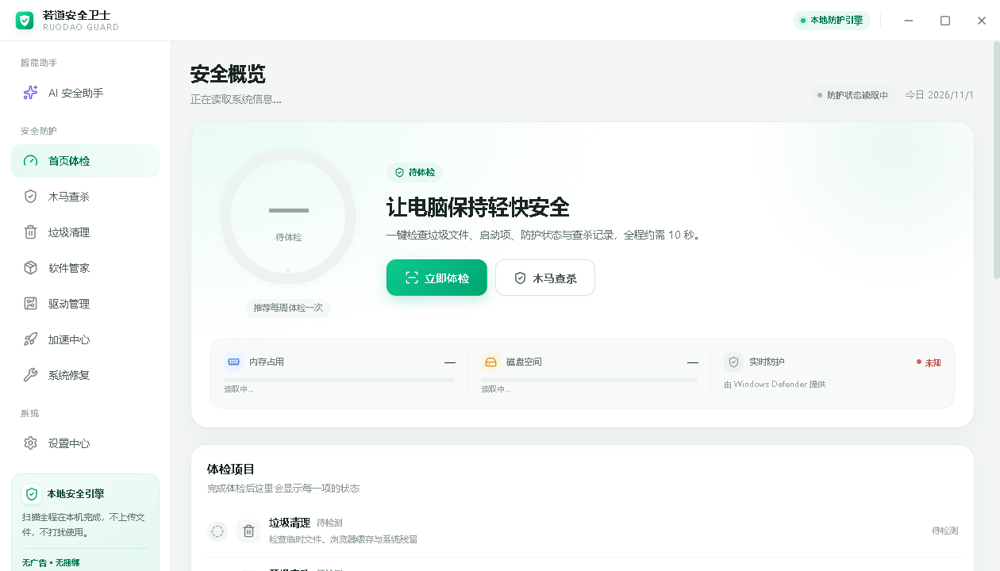 | 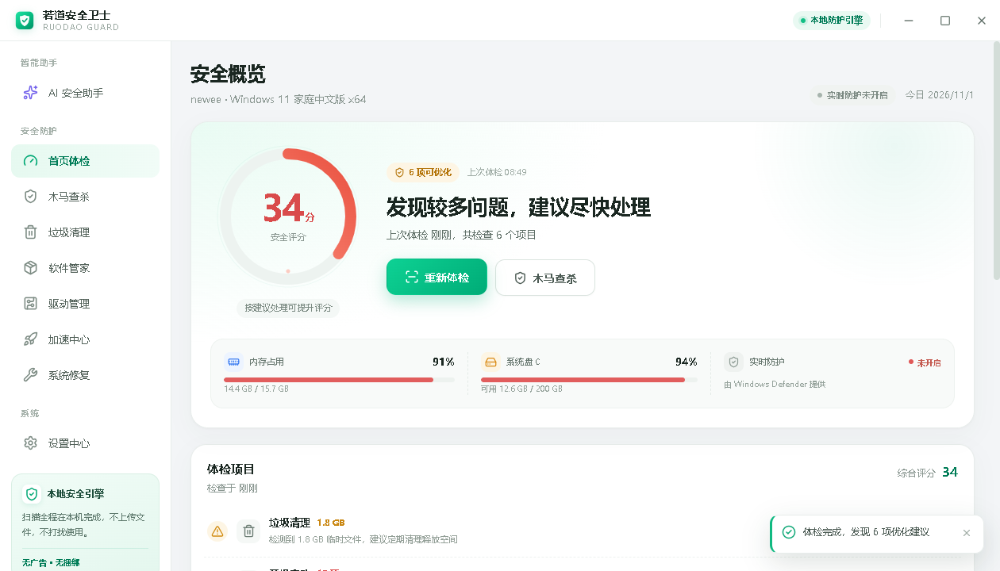 |

| 木马查杀（引擎就绪） | 查杀结果 |
| --- | --- |
| 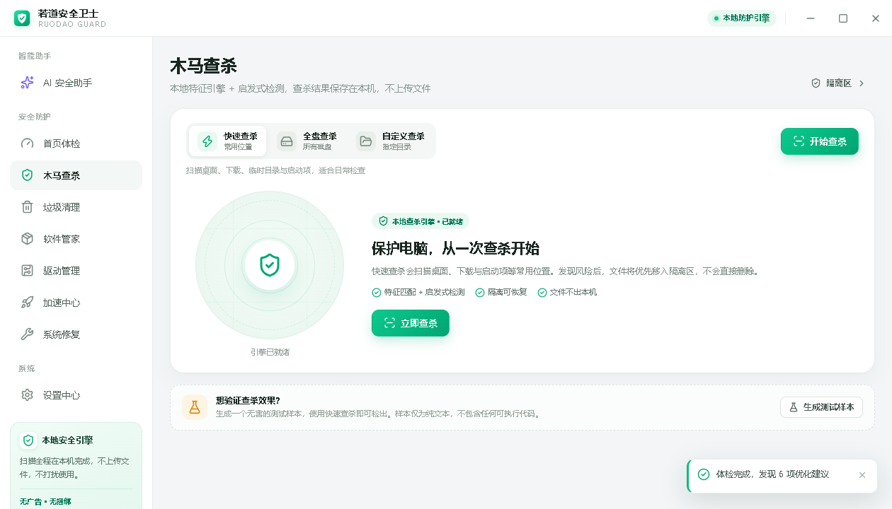 | 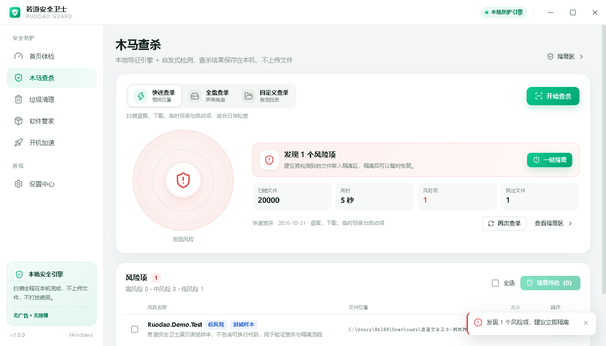 |

| 隔离区与安全隐私说明 | 垃圾清理 |
| --- | --- |
| 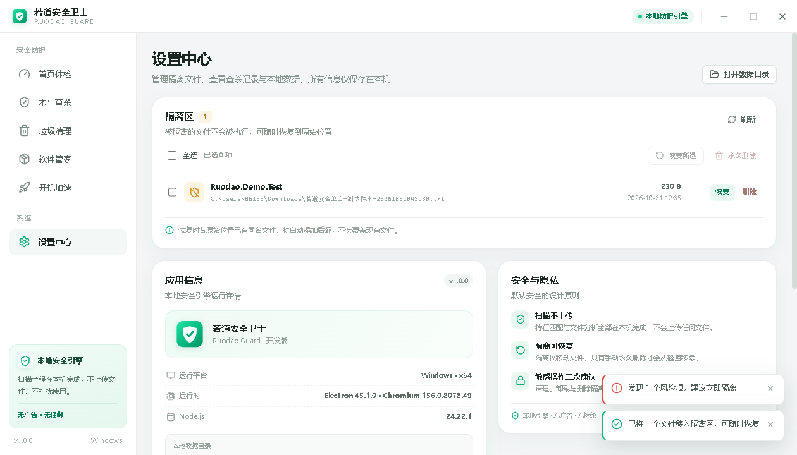 | 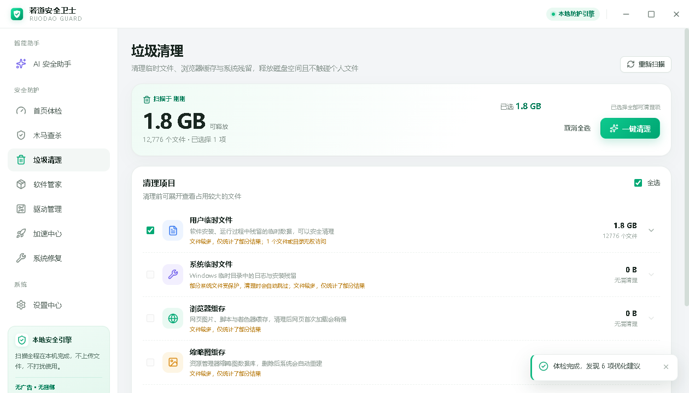 |

| 软件管家 | 驱动管理 |
| --- | --- |
| 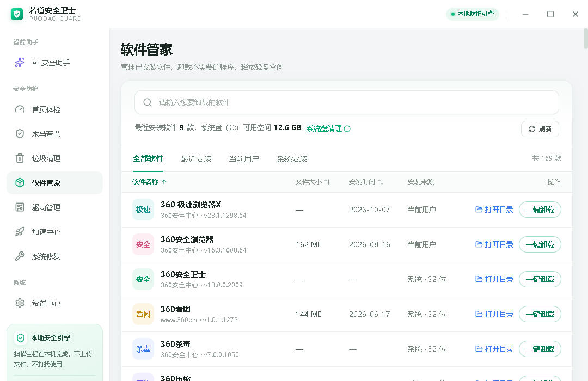 | 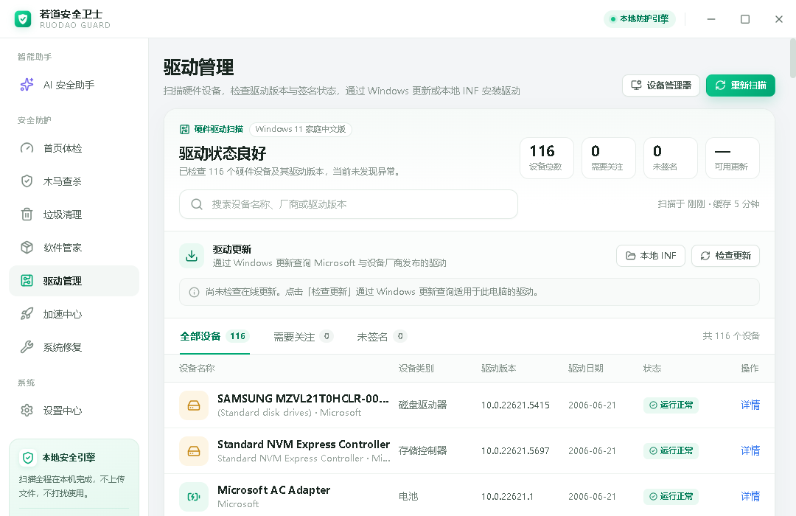 |

| 加速中心 | 启动项管理 |
| --- | --- |
| 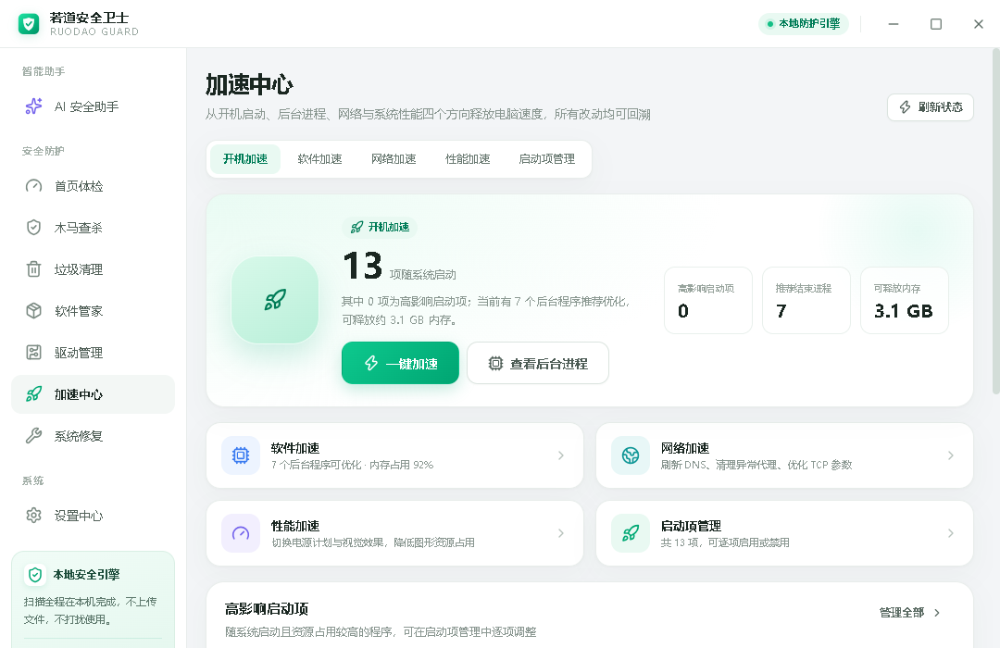 | 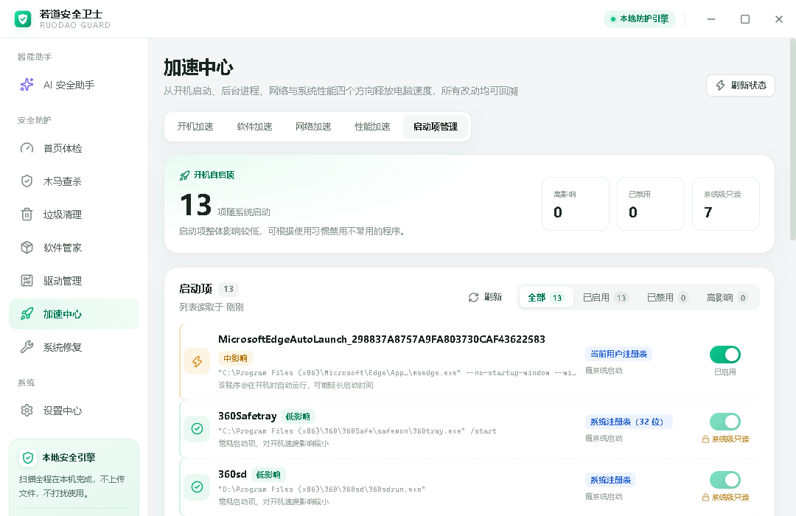 |

| 系统修复 | 修复二次确认（含备份与日志提示） |
| --- | --- |
| 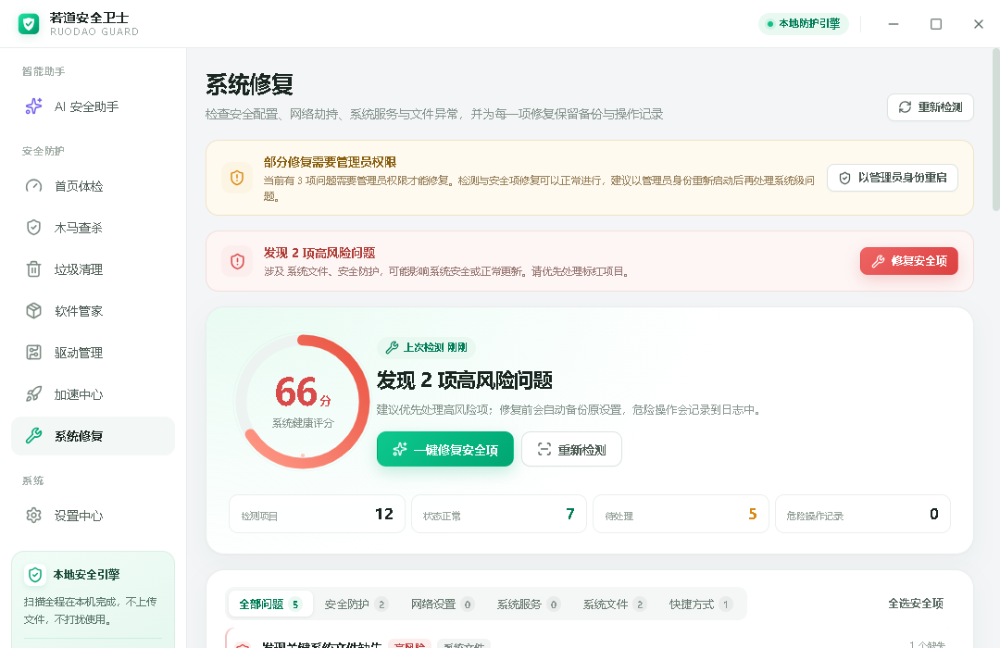 | 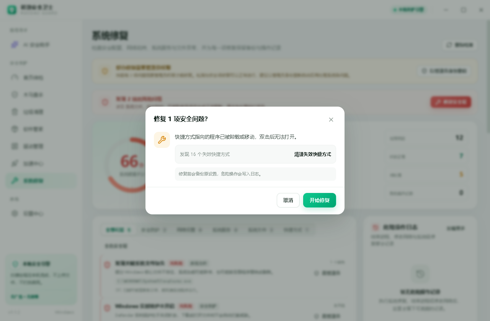 |

| AI 安全助手（欢迎页） | AI 安全助手（结合本机体检作答） |
| --- | --- |
| 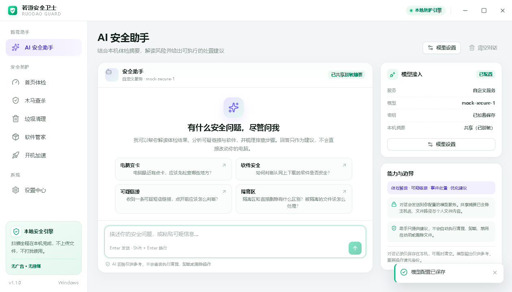 | 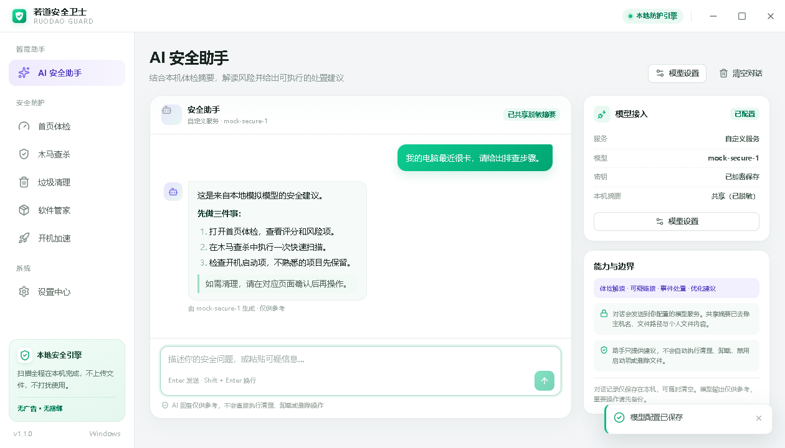 |

| 设置中心（模型接入 / 隔离区 / 应用信息） | |
| --- | --- |
| 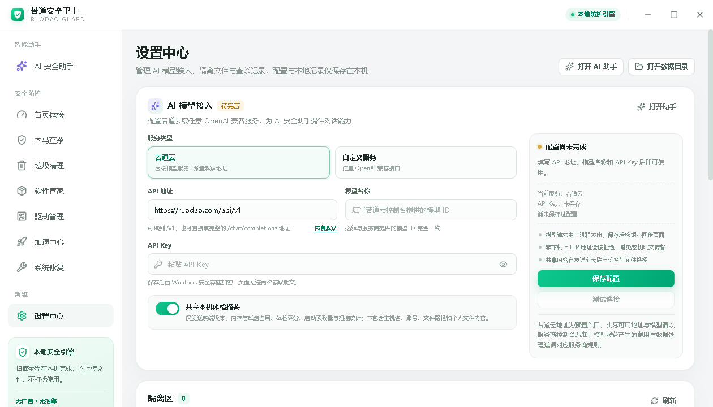 | |

---

## ✨ 功能总览

| 模块 | 能做什么 | 关键实现 |
| --- | --- | --- |
| 🩺 **首页体检** | 一次跑完系统、垃圾、启动项、防护四项检查，输出 0–100 评分 + 问题清单，每项可一键跳转处理 | 分阶段进度推送，检查耗时可感知 |
| 🛡️ **木马查杀** | 快速 / 全盘 / 自定义三种模式；SHA-256 特征匹配 + 双重扩展名启发式；命中先进隔离区 | 扫描全程本机，文件与哈希不出网 |
| 🗄️ **隔离区** | 列出 / 还原 / 永久删除；还原时若原位置已存在同名文件自动加后缀，不覆盖 | 索引 JSON 原子写入，只移动不删除 |
| 🧹 **垃圾清理** | 用户临时文件、系统临时文件、浏览器缓存、缩略图缓存、崩溃转储五类；清理前逐类查看占用 | 目录白名单 + 单次上限 + 超时保护 |
| 📦 **软件管家** | 读取三处卸载注册表（64 位 / 32 位 / 当前用户），搜索、排序、打开安装目录、一键卸载 | 优先用程序的静默卸载参数 |
| 🔌 **驱动管理** | 枚举硬件与驱动版本、识别未签名 / 需要关注的设备；经 Windows 更新查询驱动更新；支持安装更新或指定本地 INF | 提权辅助进程 + `pnputil` |
| 🚀 **加速中心** | 开机加速、软件加速（结束进程）、网络加速（DNS / TCP / Winsock / 代理）、性能加速（电源计划 / 视觉效果）、启动项管理 | 所有改动写入可回溯记录 |
| 🔧 **系统修复** | 检测关键服务、安全策略、实时防护、防火墙、UAC、待重启更新、hosts、代理、快捷方式、系统文件、启动项等十余项 | 修复前备份原配置，操作写入危险操作日志 |
| 🤖 **AI 安全助手** | 结合本机体检摘要做安全问答，流式回答、可随时中止；支持若道云与任意 OpenAI 兼容服务 | API Key 用 Windows DPAPI 加密存本地 |
| ⚙️ **设置中心** | 模型接入配置、隔离区管理、查杀记录、应用信息与数据目录 | 所有数据仅存本机 |

---

## 📥 安装

### 方式一：安装包（推荐给普通用户）

1. 打开 [Releases](../../releases) 页面；
2. 下载最新的 `RuodaoGuard-Setup-x.y.z.exe`；
3. 双击安装。安装程序支持**选择安装目录**、创建桌面与开始菜单快捷方式，**默认按当前用户安装，不需要管理员权限**。

> 安装包未做商业代码签名，Windows SmartScreen 可能提示"未知发布者"。若你不放心，请走下面的源码方式自行构建——这正是开源的意义。

### 方式二：从源码运行

```bash
git clone https://github.com/ruodaoai/ruodao-guard-desktop.git
cd ruodao-guard-desktop
npm install
npm run dev
```

打包成安装包：

```bash
npm run dist:win      # 产物在 release/ 目录
```

> 仓库自带 `.npmrc` 指向国内镜像（npmmirror）以加速 Electron 下载。若在境外网络环境，删除 `.npmrc` 或改成官方源即可。

### 系统要求

| 项目 | 要求 |
| --- | --- |
| 操作系统 | Windows 10 / 11，x64 |
| 运行内存 | 建议 4 GB 以上 |
| 权限 | **日常使用不需要管理员**；系统修复、驱动安装、部分启动项操作需要管理员，应用内提供「以管理员身份重新启动」 |
| 开发环境 | Node.js 22+、npm 10+ |

---

## 🚀 使用教程

### 1. 首页体检

打开应用默认就是体检页。

1. 点 **「立即体检」**，界面依次显示「读取系统状态 → 扫描垃圾文件 → 检查开机启动项 → 检查安全防护 → 计算健康评分」，全程约 10 秒；
2. 结束后左侧出现环形评分：**90 分以上优秀、70 分以上良好、70 以下需要处理**；
3. 右侧「体检项目」按严重程度排序（高 → 中 → 低），每条都写明**为什么扣分**和**建议怎么做**；
4. 直接点条目右侧的「去清理 / 去优化 / 去查杀」，会跳到对应功能页，不用自己找。

> 评分只看真实指标，不制造焦虑：垃圾文件、启动项数量、内存占用、磁盘剩余、实时防护状态、上次查杀结果与时效，每一项都有明确阈值（见 [体检评分规则](#体检评分规则)）。

### 2. 木马查杀

1. 选择扫描模式：
   - **快速查杀**：桌面、下载、临时目录与启动项目录，适合日常；
   - **全盘查杀**：所有本地磁盘；
   - **自定义查杀**：点「选择目录」指定任意文件夹；
2. 点 **「开始查杀」**，右侧实时显示已扫描文件数与当前路径，随时可「停止」；
3. 有命中时顶部显示风险数量，点 **「一键隔离」** 把文件移入隔离区——**不会直接删除**；
4. 扫描结果与统计自动写入本机查杀记录，「设置中心 → 查杀记录」可回看。

**想验证查杀链路是否真的能工作？** 查杀页有一张「想验证查杀效果？」的卡片，点 **「生成测试样本」** 会在下载目录生成一个纯文本的演示样本（不含任何可执行代码）。再跑一次快速查杀就能看到它被识别、隔离、可还原——完整走通一遍流程。EICAR 标准测试串同样会被识别。

> 加速小样：首次全盘扫描要遍历大量目录，扫描器会跳过 `WinSxS`、`DriverStore`、`Windows.old`、回收站等系统高危区，并对单次扫描设置文件上限，避免卡死。

### 3. 隔离区

路径：**设置中心 → 隔离区**。

| 操作 | 说明 |
| --- | --- |
| 还原 | 把文件移回原路径；若原位置已有同名文件，自动追加 `.restored` 后缀，**绝不覆盖** |
| 永久删除 | 真正从磁盘移除，需二次确认，**不可恢复** |
| 刷新 | 重新读取隔离索引 |

隔离文件静静躺在应用数据目录里，不会被执行，也不会上传。

### 4. 垃圾清理

1. 进入「垃圾清理」，等待扫描完成，顶部显示可清理总量；
2. 展开每个分类可看到**具体占用**：用户临时文件、系统临时文件、浏览器缓存、缩略图缓存、崩溃转储；
3. 勾选要清理的类别（默认全选），点 **「一键清理」**；
4. 完成后提示释放的空间与删除/跳过文件数。

> 清理只作用于**明确的缓存与临时目录白名单**，不碰你的文档、图片、下载文件。浏览器缓存清理后，网页首次加载会稍慢，这是正常现象。若某分类提示"文件偏多，仅统计了部分结果"，说明该目录文件数超过单次上限，清理时会分批处理。

### 5. 软件管家

1. 列表默认展示全部已安装软件，支持按**最近安装 / 当前用户 / 系统安装**筛选，点击表头可按名称、大小、安装时间排序；
2. 顶部搜索框输入名称即时过滤；
3. 每行右侧两个按钮：
   - **打开目录**：定位到安装位置；
   - **一键卸载**：弹窗确认后调用程序自带的卸载程序（优先静默参数）。

> 应用只读取注册表里登记的卸载信息，**不扫描文件系统、不统计"残留垃圾"**，因此列表里出现的是标准安装的程序；绿色免安装软件不会出现在这里。

### 6. 驱动管理

1. 进入页面自动扫描，顶部显示设备总数、需要关注、未签名、可用更新四个关键数字；
2. 列表可按「全部设备 / 需要关注 / 未签名」筛选，也支持搜索设备名或厂商；
3. 点 **「检查更新」** 会通过 Windows 更新在线查询适用于本机的驱动（需要 Windows Update 服务运行）；
4. 有更新时勾选后点安装；也可点 **「本地 INF」** 手动指定 `.inf` 文件安装；
5. 设备异常时点 **「设备管理器」** 直接跳系统原生工具。

> **关于风险**：驱动更新会改动系统底层。请**优先只更新标红的异常设备**，并在更新前创建系统还原点。安装过程需要管理员权限，应用会请求提权。

### 7. 加速中心

五个标签页，覆盖"电脑为什么慢"的四个方向：

**① 开机加速** —— 展示随系统启动的项数、高影响启动项、可释放内存，点 **「一键加速」** 智能禁用明显拖慢开机的项；**「查看后台进程」** 跳到进程列表。

**② 软件加速** —— 列出占用 CPU / 内存较高的后台进程（PID、CPU%、内存占用），勾选后 **「结束进程」**。危险进程会被拦截，结束动作记入危险操作日志。

**③ 网络加速** —— 四项独立开关：
| 项目 | 实际命令 |
| --- | --- |
| 刷新 DNS 缓存 | `ipconfig /flushdns` |
| 清理异常代理 | 关闭系统代理设置 |
| 优化 TCP 参数 | `netsh int tcp set global autotuninglevel=normal` |
| 重置 Winsock | `netsh winsock reset`（需重启生效） |

**④ 性能加速** —— 切换电源计划（高性能 / 平衡 / 节能）与视觉效果（最佳性能 / 平衡 / 最佳外观），改动前保存原设置。

**⑤ 启动项管理** —— 完整列出注册表 Run 项与启动文件夹项，标出来源与厂商，可逐项启用/禁用。

> **启动项禁用是可逆的**：注册表项被移动到备份区而不是删除，启动文件夹项被移动到应用数据目录并记录清单。随时点「启用」即可原样恢复——这也是本应用「所有改动可回溯」原则的体现。

### 8. 系统修复

检查范围（十余项，按类别分组显示）：

| 类别 | 检查内容 |
| --- | --- |
| 系统服务 | 11 个关键服务（加密、DNS、事件日志、WMI、计划任务、打印等）是否被停止或改错启动类型 |
| 安全策略 | 任务管理器 / 注册表编辑器 / Windows 自动更新是否被策略禁用 |
| 安全防护 | Windows 实时防护、防火墙是否开启 |
| 账户安全 | 用户账户控制（UAC）是否被关闭 |
| 网络劫持 | hosts 可疑条目、系统代理是否被恶意设置 |
| 系统文件 | 关键系统文件是否缺失（调用 SFC 扫描） |
| 待重启项 | 是否有更新等待重启完成 |
| 快捷方式 | 桌面与开始菜单的失效快捷方式 |
| 启动项 | 可疑的持久化启动项 |

使用流程：

1. 进入页面自动检测，顶部给出**系统健康评分**与项目统计（正常 / 待处理）；
2. 勾选要修的项，或直接点 **「一键修复安全项」**（只处理安全类，风险可控）；
3. 弹出确认框，**明确告知修什么、会备份什么**；
4. 执行修复（部分项需要管理员，页面顶部会提示）；
5. 修复完成，右侧「危险操作日志」留下可查记录。

> **修复前会备份原配置**，修改系统设置属于高风险操作，请逐项确认、一次只改一两项并观察系统表现。日志文件在数据目录的 `risk-events.json`。

### 9. AI 安全助手

它读得到本机体检结果，所以能回答"我电脑最近很卡，给我排查步骤"这类具体问题。

1. 首次使用先配置模型：点右上角 **「模型设置」**，或在设置中心「AI 模型接入」：
   - **若道云**：填 API Key（在若道控制台获取），可选登录若道账号自动获取模型列表；
   - **自定义服务**：任意 OpenAI 兼容接口，填 Base URL、模型 ID、API Key；
2. 点 **「测试连接」** 验证配置是否可用；
3. 回到助手页输入问题，或点推荐问题快速开始；
4. 回答**流式输出**，随时可点停止按钮中止；
5. 右上角 **「清空对话」** 清除本地会话记录。

**它不会替你动手。** 助手只输出建议与操作路径，所有清理、查杀、卸载、修改系统设置的动作都必须由你进入对应页面亲自确认——这是刻意设计的安全边界。

**上下文共享**可在设置里关闭。开启时发送的是**体检摘要**：软件版本、内存/磁盘占用、体检评分、启动项数量、扫描统计；**不包含**主机名、用户名、文件路径与任何文件内容。API Key 使用 Windows DPAPI（Electron `safeStorage`）加密后存在本机，页面上无法回读明文。

### 10. 设置中心

- **AI 模型接入**：服务类型、API 地址、模型 ID、API Key、测试连接、共享体检摘要开关；
- **隔离区**：见上文；
- **查杀记录**：历次扫描的时间、模式、文件数、风险数；
- **应用信息**：版本、Electron / Chromium / Node 版本、数据目录位置；
- **打开数据目录**：直接定位本机数据文件夹，方便审计与备份。

---

## 🔐 安全模型与隐私

这个应用要读系统信息、要改系统设置，所以它的安全设计值得单独说明。

**① 默认不出网**

除以下两种情况，应用不会发起任何网络请求：
- 你主动点「检查驱动更新」（走 Windows 更新服务）；
- 你配置并使用 AI 助手（请求发往你自己填写的模型服务）。

**没有遥测、没有埋点、没有"用户体验改进计划"。** 扫描结果、隔离文件、日志、会话记录全部落在本机数据目录。

**② Electron 安全基线**

| 措施 | 实现 |
| --- | --- |
| 上下文隔离 | `contextIsolation: true`，渲染进程拿不到 Node |
| 禁用 Node 集成 | `nodeIntegration: false` |
| 预加载白名单 | 只通过 `contextBridge` 暴露明确的 API |
| 导航锁定 | 禁止窗口内跳转，外链一律 `deny` |
| 外链白名单 | 只允许打开 `https://ruodao.com` 域名下的链接，且拒绝带用户名密码的 URL |
| 权限全拒 | `setPermissionRequestHandler` 一律返回拒绝 |

**③ IPC 参数校验**

所有渲染进程传入的参数在主进程侧强校验：字符串非空、数组长度上限、枚举白名单、PID 范围、GUID 格式、路径类型校验。**不信任前端**，非法参数直接抛错。

**④ 危险操作可回溯**

| 动作 | 保护机制 |
| --- | --- |
| 查杀命中 | 只移入隔离区，不删除；可随时还原 |
| 启动项禁用 | 注册表项移到备份区 / 文件移到备份目录并记清单，可逆 |
| 系统修复 | 修复前保存原配置，结束写入危险操作日志 |
| 结束进程 | 拦截系统关键进程，动作入日志 |
| 网络优化 | 保存原设置，提供回滚说明 |
| 永久删除 | 必须二次确认 |

**⑤ 提权最小化**

以普通权限启动，只有真正需要的动作（驱动安装、部分系统修复）才请求管理员，并单独拉起提权辅助进程执行，不在主进程里长期驻留高权限。

---

## 🏗️ 架构

### 进程模型

标准 Electron 三层结构，业务逻辑全部在主进程：

```
┌─────────────────────────────────────────────────┐
│ Renderer (React 19 + TypeScript)                │
│  页面 / 组件 / 状态，只通过 window.ruodao 调 API │
└───────────────────────┬─────────────────────────┘
                        │ contextBridge（预加载白名单）
┌───────────────────────▼─────────────────────────┐
│ Preload (src/preload/index.ts)                  │
└───────────────────────┬─────────────────────────┘
                        │ ipcRenderer.invoke
┌───────────────────────▼─────────────────────────┐
│ Main (Electron)                                  │
│  ipc.ts        参数校验 + 统一 { ok, data } 返回 │
│  services/*    系统采集、扫描、修复、AI          │
│  data/*        内置特征库                        │
└───────────────────────┬─────────────────────────┘
                        │ PowerShell / netsh / pnputil
┌───────────────────────▼─────────────────────────┐
│ Windows 系统层                                    │
└─────────────────────────────────────────────────┘
```

**统一返回约定**：主进程每个 handler 都包成 `{ ok: true, data }` 或 `{ ok: false, error }`，前端不需要写 try/catch 满天飞。**进度推送**（扫描、体检）走 `webContents.send` 广播到所有窗口。

### 目录结构

```
ruodao-guard-desktop/
├── src/
│   ├── main/                      # 主进程：全部业务逻辑
│   │   ├── index.ts               # 窗口创建、单实例锁、安全策略
│   │   ├── ipc.ts                 # IPC 注册与参数校验（唯一入口）
│   │   ├── data/signatures.ts     # 内置特征库
│   │   └── services/
│   │       ├── system.ts          # 系统快照（CPU/内存/磁盘/Defender）
│   │       ├── health.ts          # 体检评分引擎
│   │       ├── virus.ts           # 查杀引擎（特征 + 启发式）
│   │       ├── quarantine.ts      # 隔离区（索引原子写入）
│   │       ├── junk.ts            # 垃圾扫描与清理
│   │       ├── software.ts        # 已安装软件枚举与卸载
│   │       ├── drivers.ts         # 驱动扫描 / 更新查询 / 安装
│   │       ├── startup.ts         # 启动项枚举与可逆禁用
│   │       ├── processes.ts       # 进程列表与结束
│   │       ├── network.ts         # 网络诊断与优化
│   │       ├── proxy.ts           # 代理状态读写
│   │       ├── performance.ts     # 电源计划与视觉效果
│   │       ├── repair.ts          # 系统检查与白名单修复
│   │       ├── risklog.ts         # 危险操作日志
│   │       ├── powershell.ts      # PowerShell 执行封装
│   │       └── ai.ts / ruodaoAccount.ts   # AI 接入与账号
│   ├── preload/index.ts           # contextBridge 白名单
│   ├── renderer/                  # React 界面
│   │   └── src/
│   │       ├── App.tsx            # 页面路由与布局
│   │       ├── pages/             # 9 个功能页
│   │       ├── components/        # 侧边栏、评分环、Toast 等
│   │       └── styles.css
│   └── shared/types.ts            # 主/渲染共享类型（单一事实来源）
├── scripts/                       # 冒烟测试与 e2e
├── build/                         # 图标等打包资源
├── docs/screenshots/              # 本文档截图
├── electron-builder.yml           # 打包配置（NSIS）
└── electron.vite.config.ts        # 三端构建配置
```

### 技术栈

| 层 | 选型 |
| --- | --- |
| 运行时 | Electron 45（Chromium 156 / Node 24） |
| 界面 | React 19 + TypeScript 5.9，无 UI 框架，手写 CSS 变量主题 |
| 图标 | lucide-react |
| 构建 | electron-vite 6 + Vite 7 |
| 打包 | electron-builder 26（NSIS 安装包） |
| 系统调用 | PowerShell + `netsh` / `ipconfig` / `pnputil` / COM（Windows Update） |
| AI | fetch 直连 OpenAI 兼容接口，流式 SSE |
| 测试 | Playwright（Electron 驱动）+ tsx 冒烟脚本 |

### 体检评分规则

评分从 100 分开始扣减，规则完全透明：

| 检查项 | 触发条件 | 扣分 |
| --- | --- | --- |
| 垃圾文件 | ≥ 2048 MB | −12 |
| | 500–2048 MB / 100–500 MB | −7 / −4 |
| | 10–100 MB | −1 |
| 开机启动项 | 启用数 > 12 / > 8 / > 5 | −10 / −6 / −3 |
| 内存占用 | ≥ 85% / ≥ 70% | −10 / −4 |
| 磁盘空间 | 可用比例 < 5% / < 10% / < 15% | −12 / −7 / −3 |
| 实时防护 | 关闭 / 读取不到 | −12 / −1 |
| 上次查杀风险 | 存在未处理风险项 | −15 |
| 查杀时效 | 从未查杀 / > 30 天 / > 7 天 | −6 / −6 / −3 |
| 上次查杀中断 | 扫描被提前中止 | −2 |

结果取 `max(0, 100 - 总扣分)`，问题按 `high → medium → low` 排序。

---

## 🛠️ 开发

### 环境准备

```bash
node -v            # 需要 22+
npm -v
```

### 常用命令

| 命令 | 作用 |
| --- | --- |
| `npm run dev` | 开发模式启动（主进程热重启、界面 HMR） |
| `npm run build` | 类型检查 + 生产构建，产物在 `out/` |
| `npm start` | 预览生产构建 |
| `npm run typecheck` | 主进程 + 渲染进程类型检查 |
| `npm run typecheck:node` | 只检查主进程 / 预加载 |
| `npm run typecheck:web` | 只检查渲染进程 |
| `npm run smoke` | 冒烟测试（核心服务函数级验证） |
| `npm run e2e` | 端到端 UI 测试，截图落到 `test-artifacts/` |
| `npm run e2e:virus` | 查杀与隔离流程 e2e |
| `npm run e2e:ai` | AI 助手流程 e2e |
| `npm run dist:win` | 构建 + 打包 NSIS 安装包 |

### 调试

- **主进程**：`npm run dev` 后终端直接输出日志；需要断点时在 VS Code 中附加到 Electron 主进程；
- **渲染进程**：窗口内 `Ctrl + Shift + I` 打开开发者工具（生产构建已禁用菜单，开发模式可用）；
- **IPC 报错**：统一返回 `{ ok: false, error }`，前端 Toast 会显示 `error` 原文，参数校验失败会明确指出哪一项不合法；
- **临时改数据目录**：开发模式支持 `RUDAO_ACCOUNT_ORIGIN` 环境变量覆盖账号服务地址，便于本地联调。

```bash
# 示例：只跑主进程类型检查
npm run typecheck:node
```

---

## 📦 构建与打包

```bash
npm run dist:win
```

产物：`release/RuodaoGuard-Setup-<version>.exe`

打包配置要点（`electron-builder.yml`）：

| 项 | 值 |
| --- | --- |
| appId | `com.ruodao.guard` |
| 安装方式 | NSIS，非一键安装，可改安装目录，按当前用户安装 |
| 架构 | x64 |
| 快捷方式 | 桌面 + 开始菜单（「若道安全卫士」） |
| asar | 开启 |

> 未做代码签名。若你 fork 后要正式分发，请自行配置签名证书（`win.certificateFile` / `CSC_LINK`）。

---

## 🧪 测试

仓库自带三层验证，都可在本地跑：

| 层级 | 命令 | 覆盖内容 |
| --- | --- | --- |
| 类型 | `npm run typecheck` | 主进程、预加载、渲染进程全量类型 |
| 冒烟 | `npm run smoke` | 系统快照、垃圾扫描、体检评分、查杀引擎、隔离区等核心服务 |
| 端到端 | `npm run e2e` | 启动真实窗口，遍历 9 个页面并截图 |
| 专项 e2e | `npm run e2e:virus` / `npm run e2e:ai` | 查杀→隔离→还原全链路；AI 配置与对话流式输出 |

e2e 使用 Playwright 驱动 Electron，截图默认输出到 `test-artifacts/`（已在 `.gitignore` 中忽略）。

---

<a id="disclaimer"></a>

## ⚠️ 能力边界与免责声明

开源项目最该做的是把话说清楚。以下都是事实，不是免责套话：

**它不是杀毒软件。** 内置特征库（`src/main/data/signatures.ts`）目前只有 EICAR 标准测试样本一条记录，检测主要依赖**文件名启发式**（如 `报告.pdf.exe` 双重扩展名）。它能识别已知的伪装手法和测试样本，**不可能**识别真实世界的新增恶意软件。**请保持 Windows Defender 开启，不要卸载正经杀毒软件。**

**它不驻留、不实时防护。** 没有常驻后台服务、没有文件系统过滤驱动、没有内核驱动。查杀是你主动触发的一次性扫描。

**它改的是系统真实配置。** 加速中心与系统修复会修改注册表、服务启动类型、网络栈参数、电源计划等。虽然做了备份与日志，**误操作仍可能影响系统表现**。建议：一次只改一两项、改动前建还原点、在公司/生产机器上先小范围验证。

**驱动更新有真实风险。** 更新错驱动可能导致蓝屏或设备不可用，务必只更新确实异常的设备和有把握的更新。

**AI 输出仅供参考。** 模型可能给出不准确甚至有害的建议，请自行判断。

**软件按 MIT 协议「按原样」提供。** 作者不对因使用本软件造成的任何数据丢失、系统损坏或业务中断承担责任。**在重要机器上使用前，请先备份。**

---

## 🗺️ 路线图

- [ ] 可订阅的远程特征库（HTTPS + 签名校验，失败自动保留原库）
- [ ] 查杀支持进程内存扫描与计划任务持久化检查
- [ ] 隔离区支持导出取证包
- [ ] 体检报告导出为图片 / Markdown，便于求助时贴给别人看
- [ ] 深色主题（当前仅浅色）
- [ ] macOS / Linux 的基础系统信息支持（当前仅 Windows）
- [ ] 完善 e2e 覆盖率，接入 GitHub Actions 自动跑

有想做的功能欢迎开 Issue 讨论。

---

<a id="contributing"></a>

## 🙏 参与贡献

欢迎任何形式的参与：报 Bug、提需求、改文档、写代码。

1. Fork 本仓库并从 `main` 切出分支（`feat/xxx`、`fix/xxx`）；
2. 改完确保 `npm run typecheck` 与 `npm run build` 通过；
3. 提交 PR，说明**改了什么、为什么改、怎么验证的**（附截图更好）。

详细约定见 [CONTRIBUTING.md](CONTRIBUTING.md)。安全漏洞请勿公开 Issue，走 [SECURITY.md](SECURITY.md) 的流程。

**特别欢迎的贡献**：补充启发式检测规则、增加更多可逆的系统检查项、把界面做得更好看、把这套代码翻译成更多语言。

---

## 📄 许可证

[MIT](LICENSE) © 2026 Ruodao

你可以自由使用、修改、分发，包括商业用途，只需保留版权声明。

---

<div align="center">

**如果这个项目对你有帮助，点个 Star ⭐ 就是最好的支持。**

[若道官网](https://ruodao.com) · [插件版仓库](https://github.com/ruodaoai/ruodao-guard) · [更多开源项目](https://github.com/ruodaoai)

</div>
